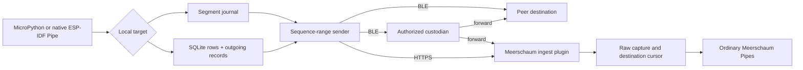

# MicroMeerschaum architecture evaluation

The first release should let two microcontrollers sync a Pipe while both are offline. A node can also forward records to a standard Meerschaum instance. Keep the Pipe names, source-plugin convention and choice of local instance familiar. Give delivery its own operation and receipt, since a successful local sync can precede contact with another node by days. [Peer sync example](peer-sync.md) · [Project scope](adr/0001-support-independent-meerschaum-deployments.md)

**Storage decision.** Ship a reusable, single-medium segment journal for collection and replay. Offer SQLite on qualified devices that need ordinary rows, filters and keyed updates. A SQL-backed Pipe commits its row changes and outgoing records in the same database transaction. Keep the same identity and delivery contract for both. The FlashDB experiments below explain why adopting its stock file backend would leave substantial recovery and retention work with this project. [Segment decision](adr/0007-use-segments-for-the-first-supported-journal.md) · [SQLite decision](adr/0010-offer-an-optional-on-device-sqlite-instance.md)

## Baseline and release implementation

The source baseline for this evaluation is MicroMeerschaum `0fece89`, the storage proposal in PR #1 at `522b0f1`, and Meerschaum 5.1.5. The C11 library provides pipe key validation, CRCs, record and batch framing, whole-batch validation and segment scanning with caller-owned buffers. Its ESP-IDF component builds the same sources. The Rust crate implements the wire format independently, borrows payload bytes and has no third-party crate dependencies. The Rust archive example reads segments and reports gaps and overlaps. An independent Python generator supplies valid and malformed fixtures to both implementations. Version 0.1.0 adds generation-scoped exchange, native and MicroPython bindings, the Arduino library, two device storage profiles, BLE relay custody and a native Meerschaum receiver. [Release qualification](qualification.md) · [C API][c-api] · [Rust crate][crate] · [Archive scanner][dump] · [Storage proposal][proposal]

A v0 record can hold up to 65,536 payload bytes. A segment contains consecutive records under a pipe key and first sequence. Only the batch carries the origin and up to eight lineage hops. Importing a standalone v0 segment therefore requires a trusted source for its origin. The v1 protocol adds a generation so a node that loses its sequence state can restart numbering while old media remain readable. [Wire specification][wire] · [Stream generations](adr/0006-identify-stream-generations.md)

## Structure of an independent deployment

Start with a source plugin on node A, a local journal, and node B configured as the destination for one Pipe. After B durably accepts observations over BLE, A can resume subsequent deliveries from B’s receipt. An operator can configure B to forward A’s stream, originate a separate stream, or do both. A server deployment adds an ingest plugin to an ordinary Meerschaum API instance and maps incoming documents to registered Pipes. These paths share the record identity, payload bytes and retry rules. [Two-node release example](peer-sync.md#initial-release-example) · [Built-in document mapping](adr/0008-include-a-dictionary-to-pipe-path.md)

| Interface | MicroMeerschaum supplies | Application or operator supplies |
| --- | --- | --- |
| Source → local Pipe | MicroPython and native ESP-IDF Pipes accept supplied rows or fetch from a configured source. A native driver may also submit compact payloads. The segment journal provides durable append, reopen, and bounded reads by sequence. | Sensor driver, optional binary schema, acquisition timing and board power policy. [Device API](device-api.md) · [Device journal](adr/0003-ship-a-single-medium-device-journal.md) |
| Local target → sender | Whole records within a byte budget, addressed by origin, Pipe key, generation and sequence. Distinguish a gap, a read failure, an oversized record and end of data. | Provisioned node identity, media lifecycle and connection schedule. [Wire specification][wire] |
| Sender → peer | Resumable BLE GATT exchange. A destination accepts durable capture. An authorized relay can instead accept custody until onward transfer. Both identify which stream and prefix their receipts cover. | Named destinations, trusted custodians, credentials and transport configuration. [Peer delivery](peer-sync.md) · [BLE custody](adr/0005-support-ble-custody-and-micropython.md) |
| Sender → Meerschaum instance | HTTPS sender example and installable ingest plugin using the Rust decoder. Bind the caller to permitted origins and Pipes, store raw data and lineage, and acknowledge the durable prefix. | An ordinary API instance, access configuration, and a mapping from source streams to registered targets. [Host plugins][plugins] · [Capture decision](adr/0004-acknowledge-a-durable-prefix-at-the-destination.md) |
| Raw data → rows | Replayable raw input and a built-in materializer for flat documents. Preserve origin, Pipe key, generation, sequence, boot, monotonic time, kind, bytes and observed routes. | For binary sensors, a plugin maps one record to zero or more rows and supplies event-time policy. Operators choose target Pipe keys and row identity. [Ordinary Pipes][pipes] |

The standard Meerschaum sync endpoint accepts documents and line-form data. The installable plugin adds binary ingress and durable stream receipts. Its independent materializer uses the ordinary Pipe API, so existing clients can query rows, schedule jobs and build dependent Pipes in the usual way. An incoming connector label is data. The operator’s mapping determines which installed code and destination Pipe handle it. [Stock sync route][stock] · [Meerschaum sync][syncing]



### Authoring Pipes in MicroPython and native ESP-IDF

A Meerschaum user can write a Python source plugin while the standard Pipe API delegates work to the Rust kernel. On the device, a Python module or a compiled ESP-IDF driver can supply a named Pipe. Both environments have the full collection and delivery workflow, including batched documents and a local commit while the radio sleeps. Both delegate persistence and retry to the portable C core. High-rate native producers can supply caller-owned buffers. Changing the firmware language preserves the receiver mapping and downstream Pipes. [Host Python sync implementation][host-dispatch] · [Device APIs and migration test](device-api.md)

The following example uses the MicroPython source-plugin API. A MicroPython device with a configured journal exposes free heap as a regular source plugin. It takes one module to supply data.

```python
# health.py (install on the device module path)
import gc

def fetch(pipe, **kw):
    return [{"free_bytes": gc.mem_free()}]
```

```python
# Device application
from micromeerschaum import Pipe

memory = Pipe("plugin:health", "memory", "controller")
memory.sync()  # Fetch and commit locally, including while offline.
```

A caller with a reading already in hand can use `memory.sync({"free_bytes": value})`. The same durable write path accepts both inputs. Positive completion means the selected local target has committed the data. For `sql:local`, that includes both the row update and its outgoing record. A later transfer returns a stream-scoped custody or destination receipt. On the server, the built-in document materializer publishes the row to the configured ordinary pipe. Equal values from two successive samples are legitimate observations. A transport retry reuses the existing record identity. An update to a keyed output row follows that pipe’s own parameters. [Built-in document path](adr/0008-include-a-dictionary-to-pipe-path.md) · [Device source plugins](adr/0009-make-micropython-and-source-plugins-first-class.md)

Use the familiar `plugin:<name>` convention to resolve a configured device module. Support an optional `register(pipe, **kw)` hook for defaults. A board image can contain the native journal binding and a frozen source module, or the operator can install the same trusted Python module on its filesystem. A wire key received over BLE or HTTPS identifies incoming data. The receiver’s configured mapping determines which code runs. The standard Meerschaum server continues to host the separate ingest plugin and downstream application plugins. [Host source plugin example][host-source] · [MicroPython packages][mp-packages] · [Frozen modules][mp-freeze] · [Native C bindings][mp-cmodule]

Qualify ease of use and performance with two paths. First, install a source module on a supported MicroPython board and materialize its first row without a custom decoder or firmware rebuild. Second, replay a synthetic high-rate sensor stream through the C API on the same journal, measuring peak memory, maximum acquisition stall and commit throughput at the same durability interval. Confirm the shared decoder accepts both paths. A buffered acquisition call should report queued observations separately from a successful durable `Pipe.sync()`.

### Delivery and recovery obligations

- **Local commit and remote delivery.** A local sync succeeds after its target commits. A custody receipt from an authorized relay allows the previous custodian to release the accepted prefix. The new custodian must retain and forward it. A destination receipt confirms durable raw capture there. A parser can be repaired and replayed later. [Custody](adr/0005-support-ble-custody-and-micropython.md) · [Destination receipt](adr/0004-acknowledge-a-durable-prefix-at-the-destination.md)
- **Gaps, replay and concurrency.** Persist out-of-order ranges. Advance the receipt only over records or explicitly declared loss. Replaying identical records over another path adds route evidence. A conflicting payload at an existing identity needs investigation and cannot establish new coverage. Coordinate raw capture and cursor updates across concurrent writers and restarts. [Peer lineage](peer-sync.md#preserving-lineage)
- **Generation and sequence allocation.** A durable next-sequence floor protects identities across reopen and media replacement. A receiver can only report records it has seen. After losing local sequence authority, start a new generation before appending. Old media retain their original identity. Specify an exact encoding for 64-bit values through all receipt and transport layers. [Stream generations](adr/0006-identify-stream-generations.md) · [Wire limits][wire]
- **Loss at capacity.** By default a full Pipe protects accepted, unacknowledged records. A Pipe may choose to retain newer observations instead. Persist missed-observation counts for samples never numbered and explicit ranges for evicted records. Reserve space or equivalent durable state for this accounting before filling the data area. [Retention](adr/0002-configure-retention-per-device-pipe.md)

## How much carries over from Meerschaum?

The [Meerschaum design reference](meerschaum-design.md) traces the upstream lifecycle from Pipe registration to a hosted materializer. Its reproducible SQLite case covers a historical correction missed by a successful incremental copy, nullable row keys, bounded reads and sync results. Use it as the behavioral reference when implementing the common subset.

An experienced Meerschaum user should recognize the source/metric/location vocabulary, incremental work and the entire workflow once rows reach an instance. A plugin author should recognize the materializer immediately. An embedded integrator needs to learn where the only durable copy is and who is allowed to release it. This is a design assessment. No usability study has established how quickly users learn it. [Meerschaum glossary][mrsm-glossary] · [Meerschaum sync][syncing] · [Device wire model][wire]

| Standard Meerschaum concept | Closest MicroMeerschaum concept | What the user can carry over |
| --- | --- | --- |
| Pipe named by connector keys, metric and optional location, stored on an instance | Device pipe named by the same three labels at an origin | Use the familiar names and argument order. A device's connector label need not resolve to a configured server connector. Devices can share the same label tuple. The supported design also scopes record identity by generation. |
| Fetch a bounded range, filter existing rows, write or upsert | Read a sequence range, recognize repeated records, durably accept the range | Incremental transfer and retry feel familiar. A record's bytes are immutable under its identity. A derived Meerschaum row can be corrected or upserted according to its pipe's parameters. |
| Pipe sync time and optional backtrack | A receiver’s accounted-for prefix and the sender’s last receipt | Both describe progress. An ordinary sync time can be a datetime or integer and describes an axis value. A receipt carries authority to reclaim and must account for gaps. |
| Pipe target, data types and indices | The ordinary destination pipes produced by a materializer | Register targets, configure columns, write plugins, inspect rows and schedule jobs using existing Meerschaum tools. A device journal carries opaque records and has no obligation to mirror a table’s schema. |
| Source connector and instance connector | A device source plugin supplies readings. The instance identifies the target of a write. | A local Pipe can use the journal or a local SQLite instance. A provisioned peer instance lets a caller target a remote Pipe directly. A local collector can also forward committed readings while tracking delivery separately. [Where a Pipe lives](peer-sync.md#where-does-a-pipe-live) |
| Parent/child pipe dependencies and engine progress | Batch lineage and materializer progress | Pipe dependencies describe which datasets derive from others. Relay hops describe the journey of the same record. An ordinary Meerschaum graph begins wherever derived data needs it. |

Consider two thermometers that both call their stream `(thermometer, temperature, greenhouse)`. Each can write sequence 1. The receiver preserves both because they have different origins. A materializer can expose one ordinary temperature pipe with event time, sensor ID and value. Its consumer can query it using standard Meerschaum. If the east thermometer’s record 102 arrives first, its raw bytes are available immediately. A missing record 101 can hold back the receipt even while the destination already has a row with a later event time. [Meerschaum pipe constructor][pipe-init] · [Sync-time API][sync-time]

I checked the progress analogy using an isolated **ordinary Meerschaum 5.1.5 SQLite pipe** with `columns={"datetime": "seq", "id": "sensor_id"}` and an integer `seq`. Syncing east-sensor documents numbered 100 and 102 succeeded. `get_rowcount()` returned 2 and `get_sync_time()` returned 102. If a MicroMeerschaum destination had previously accounted through 100, receiving the same 102 while 101 was outstanding would leave its durable prefix at 100. This small example is enough to explain why a receipt needs its own name and field. [Sync-time API][sync-time] · [Receipt decision](adr/0004-acknowledge-a-durable-prefix-at-the-destination.md)

For a first-use test, ask a Meerschaum user to install a source plugin, add the second thermometer, and read both sensors’ rows from one configured Pipe. Then disconnect one node and have the user identify which readings are committed locally and which the peer has accepted. Run the walkthrough against a named board, firmware build and host plugin version. The dictionary path lets a user complete the round trip before writing a binary decoder. [MicroPython API](adr/0009-make-micropython-and-source-plugins-first-class.md)

## SQLite on the microcontroller

**Support both profiles in the first release.** The default segment journal is sufficient for capture, ordered replay, loss accounting and transfer. Use `instance="sql:local"` on a qualified board when users need ordinary rows they can query or correct locally. The reason to bring in SQLite is the user-facing Pipe behavior it supplies. Building indexes, typed filters, keyed updates and crash-consistent changes to several tables over segment files would create a second database engine to maintain. [Device SQLite decision](adr/0010-offer-an-optional-on-device-sqlite-instance.md) · [Standard Pipe parameters][host-upsert]

| Local task | Default segment journal | Optional SQLite device instance |
| --- | --- | --- |
| Collect while disconnected and retry a sequence range | Group-commit records to segments and read by sequence. | Append immutable outgoing records transactionally and read them by the same identity. |
| Correct a previous measurement | A correction can be another immutable record for the destination materializer. | A correction updates the local row with the same declared key and appends a new outgoing record. |
| Read one sensor over a time range | Range reads operate on record sequence. Applications needing indexed event-time queries select a device instance. | `get_docs(begin, end, params, limit)` returns bounded dictionaries using the event axis and supported named-column filters. `get_sync_time()` reads the relevant axis value. |
| Reclaim after a receipt | Retire eligible segments according to retention and custody rules. | Delete eligible outgoing records. The pipe’s local rows have their own retention policy and can remain queryable. |

**One local transaction per committed group.** A SQL-backed pipe binds the logical row updates, sequence allocation, immutable record bytes and next-sequence state to the same database transaction. After success the row is visible and the transfer can be retried after reboot. A correction synchronized twice by the transport reuses the original outgoing identity on retry. A new application write receives a new sequence. The SQLite profile writes its outgoing records to that database, so it avoids a second append to a segment file and the dual-write recovery problem. Receipts are persisted separately when delivery occurs. An unavailable or replaced database still requires a reliable stream-generation rule. A SQLite commit cannot also commit an external NVS update or another card. [Local target decision](adr/0010-offer-an-optional-on-device-sqlite-instance.md) · [Stream generations](adr/0006-identify-stream-generations.md)

**Checked against stock Meerschaum.** On a clean 5.1.5 SQLite instance, a `plugin:readings` source returned a temperature of 21.4 at tick 102 for the east sensor. A second sync corrected that value to 21.7. A third sync added a late measurement of 20.9 at tick 100. With upsert enabled and `(tick, sensor_id)` as the row key, `get_docs(begin=100, end=103, params={"sensor_id": "east"}, limit=10)` returned two rows, 100 → 20.9 and 102 → 21.7. The sync time remained 102. The equivalent device must also have three distinct outgoing records before reclamation. The desktop test used a plugin returning a list and one-element lists for supplied rows. A single flat scalar-valued dictionary failed conversion in that 5.1.5 setup. Accepting it directly in MicroPython is a deliberate convenience. The list-of-documents form should work across both. [Standard sync and upsert][host-upsert] · [Standard document reads][host-reads]

The desktop 5.1.5 SQLite input-shape check synced the same two observations as a list of dictionaries, a dictionary of lists and a pandas DataFrame into three fresh Pipes. All three returned the same tick and temperature values. Calling `copy_to()` on the third Pipe reproduced its two rows and its datetime-column setting on a second SQLite instance. These cases give the device binding a reference for input shapes and distinguish a definition-and-data copy from raw delivery. [Standard sync signature](https://github.com/bmeares/Meerschaum/blob/v5.1.5/meerschaum/core/Pipe/_sync.py#L735-L746) · [Standard copy method](https://github.com/bmeares/Meerschaum/blob/v5.1.5/meerschaum/core/Pipe/_copy.py)

**Timestamps, keys and retries.** In a separate desktop 5.1.5 SQLite check, a push Pipe with `autotime=True`, `upsert=True` and a `(ts, sensor_id)` key accepted a column batch for two sensors. Both rows received the same generated timestamp. Replaying the stamped rows kept two rows. Correcting one value under its original key and repeating `copy pipes --sync-data incremental` propagated the correction and kept two rows at the second instance. A device taking multiple readings from the same sensor in one frame needs distinct sample keys or explicit sample times if each reading should remain a separate row. [Host autotime behavior](https://github.com/bmeares/Meerschaum/blob/v5.1.5/crates/meerschaum-engine/src/sync.rs#L1020-L1046) · [Pipe upserts][host-upsert]

For a device Pipe using `autotime`, preserve a supplied event time. When the origin generates a timestamp at local sync, include it in the committed document so upload and replay retain it. Samples buffered before sync may need acquisition times from the driver. On a node without valid UTC, preserve boot and monotonic capture time and expose the missing wall-clock information. A materializer can use a later clock anchor where available. A fresh application observation gets its own journal identity even when its value equals an earlier sample. Retrying a committed record reuses that identity. A SQLite Pipe applies each keyed correction to its logical row and stores the corresponding outgoing record transactionally. [Device SQLite decision](adr/0010-offer-an-optional-on-device-sqlite-instance.md) · [Scheduled journal delivery](peer-sync.md#capture-now-send-on-the-applications-schedule)

**What the board must provide.** SQLite on a microcontroller needs a filesystem port with a working synchronization and recovery contract. MicroPython v1.28 does not ship the CPython `sqlite3` module. A C-backed device instance can use the same SQLite engine from both runtimes. The community `esp_sqlite3` v0.3.3 component lists ESP32-S3 support and ESP-IDF >=5.5. Its author measured a 432.4 KiB minimal library on ESP32-C5 with ESP-IDF 6.1. Measure binary growth, total peak heap, scratch/WAL or rollback space, query latency and acquisition stalls on the selected build. [MicroPython library index][mp-libs] · [ESP component manifest][esp-sql-manifest] · [Measured configuration][esp-sql-size]

**Which port to qualify.** In the reviewed `esp_sqlite3` revision, the VFS can treat `ENOSYS` or `EINVAL` from a synchronization call as success. Its published reset test used software restarts on SPIFFS. In the reviewed MicroPython `usqlite` VFS, the file-existence callback reports absence regardless of the requested path. Recovery of a hot rollback journal depends on being able to detect it. Evaluate a pinned native port with checked write, sync, open, lock, truncate and recovery behavior and verify a single-owner or tested multi-owner locking model. Test actual power cuts during row/outgoing-record commit and cursor reclamation, disk-full rollback, and reopen on the intended medium. Run these tests alongside a replay of the desktop Pipe behavior above. Version 0.1.0 uses the pinned SQLite 3.51.3 amalgamation and a checked, single-owner LittleFS VFS. It passed host recovery tests and two ESP32-S3 QEMU boots with injected sync errors. [Released implementation and tests](device-sqlite.md) [ESP VFS][esp-sql-vfs] · [Test method][esp-sql-test] · [MicroPython port VFS][usqlite-vfs] · [SQLite recovery requirements][sqlite-atomic]

## Storage engine comparison

PR #1 names FlashDB TSDB as its only external candidate. Its baseline is the file segment implementation. The additional comparisons below were selected because each could remove a different part of the writer. A filesystem, a FIFO, a TSDB, and a transactional store take responsibility for different failures. [PR #1][proposal]

| Choice | Work it can remove | Work that remains and recommendation |
| --- | --- | --- |
| **Segments on LittleFS or FAT** | Share segment rotation, validated record iteration, range lookup, recovery and group commit across applications. LittleFS already owns allocation, copy-on-write filesystem updates and flash wear leveling. FAT supports removable, host-readable SD. | MicroMeerschaum owns the segment invariants, tested barriers, indices or hints if needed, and reclaim-through logic. One file interface can serve onboard flash filesystems, removable media and existing archives. **Selected for the first supported journal.** [Storage decision](adr/0007-use-segments-for-the-first-supported-journal.md) · [littlefs][lfs] |
| **FlashDB TSDB** (Apache-2.0) | Supplies variable-length append, write-completion state, sector allocation, timestamp lookup and range iteration. A complete encoded record can remain opaque to the engine. | Strictly increasing signed timestamps fit one local generation if bounded to `INT64_MAX`. Two pipes can both issue sequence 1. Out-of-order relay arrival needs a separate index or separate storage strategy. File sync and rollover required additional ownership in the host probe. Consider a pinned raw-flash adapter for a particular device if it passes the qualification below. [Types and controls][fdb-types] · [Append and search][fdb-tsdb] |
| **Apache Mynewt / Zephyr FCB** (Apache-2.0) | A FIFO of checksummed entries on raw sectors. The caller controls when to rotate the oldest sector. That maps well to acknowledged-sector reclamation. | The port needs the OS mutex and flash-map interfaces, plus a sequence index or scan. Zephyr limits whole entries to 16,383 bytes. Removable FAT media and the full v0 envelope need additional handling. Worth evaluating for a future Zephyr raw-flash device. [FCB contract][fcb] · [Zephyr limits][fcb-header] · [Mynewt port surface][mynewt] |
| **Rust sequential-storage** (MIT or Apache-2.0) | A checksum-protected NOR-flash queue with peek, pop and optional overwrite. Non-destructive peek followed by later retirement can support replay. | Each item must fit in an erase page and within 65,535 bytes. Pop requires multiwrite NOR. Using async Rust flash traits from the portable C journal would introduce a port and a language boundary. A better candidate for an already-Rust device. [Queue API and constraints][seq-store] |
| **SQLite** (public domain) | Transactions and indexed ranges can cover records and checkpoint updates on a single volume. A gateway receiving interleaved streams and running local queries could benefit. | Requires a qualified VFS with working sync, and adds a pager, transaction journal and indexes. A sequence floor living only on an SD card leaves with the card. Favor it where multi-stream transactions or queries justify the footprint. Selected as the optional on-device relational instance and outgoing journal for SQL-backed pipes. Its VFS must qualify on a named board. [SQLite decision](adr/0010-offer-an-optional-on-device-sqlite-instance.md) [SQLite atomic commit][sqlite-atomic] · [Footprint][sqlite-size] |

### What was measured on FlashDB

The upstream tagged release at the time of review was 2.2.0. The probe used development revision `6c722f169f27f99f96670ee00c27b2f59b1505e2` (2.2.99), which includes a fix for releasing the lock when an existing damaged store opens with automatic formatting disabled. Configuration was POSIX file mode, TSDB only, variable-length records, signed 64-bit timestamps, four fresh 4,096-byte sectors, 39-byte synthetic payloads and real 32-byte v0 headers. Each test used its own fresh directory. [Release][fdb-release] · [Upstream fix][fdb-fix] · [Reproducible host probe](evidence/flashdb-posix-probe.c)

| Test | Observed result | Consequence for a durable journal |
| --- | --- | --- |
| Commit record 1 normally. During record 2, inject `EIO` from the POSIX `fsync` call. | One failed sync. Append returned `FDB_NO_ERR`. | A caller relying on that result could discard its buffered copy before it knows the record is durable. This demonstrates a false success return. The test did not simulate physical data loss. |
| Disable rollover, fill the store, mark all 168 records deleted, verify the 168 statuses, retry record 169. | The first and second attempts both returned `FDB_SAVED_FULL`. | Marking acknowledged records does not itself reclaim writable capacity. A long-lived application needs an explicit safe reclamation mechanism. |
| Enable rollover, fill the virgin store, append record 169 without acknowledging anything. | Append succeeded. The oldest remaining sequence was 43. | One rollover reclaimed a sector containing sequences 1–42. The application must establish eligibility before allowing the engine to wrap. |

The selected layout has a 44-byte sector header and a 24-byte per-record index on the host. A 39-byte payload takes 71 encoded bytes, or 95 bytes in TSDB before sector slack. At four sectors the measured capacity was 168 such records. A v0 maximum payload needs 65,568 encoded bytes and therefore at least a 128 KiB power-of-two TSDB sector when stored whole. FlashDB also requests synchronization for each completed entry. The segment writer can share a barrier across a group of records. These observations affect small flash partitions, range-read time, radio duty cycles and acquisition stalls. Hardware measurements must determine the actual costs. [TSDB layout and append][fdb-tsdb] · [Sector geometry][fdb-geometry]

The issues extend beyond one unchecked return. The POSIX erase path also ignores some fill-write and synchronization results. The libc backend uses unchecked `fflush`. The bundled ESP32 raw-flash example passes through ESP-IDF return codes, while the FlashDB/FAL path treats negative returns as errors and some ESP-IDF failures are positive. Porting needs explicit error translation. Set the no-format control before opening existing media, distinguish fresh provisioning from recovery, and inspect metadata/rollover failure paths. Raw flash deserves its own evaluation even if a POSIX port is fixed. [File backend][fdb-file] · [ESP32 example][fdb-esp] · [FlashDB adapter][fdb-utils] · [ESP-IDF codes][idf-errors]

### What vertical integration costs

The default journal owns record ordering, group commit, segment rotation, recovery, range iteration, eligible reclamation and loss reporting. A filesystem already supplies allocation and its own recovery mechanisms. The application owns acquisition buffers, card insertion and removal, flush scheduling, power and hardware diagnostics. Keep those board-specific choices outside the portable single-medium journal. The same reader interface can serve two media and let an application merge their ranges. [Device journal](adr/0003-ship-a-single-medium-device-journal.md) · [littlefs][lfs]

A candidate engine can reduce maintenance if it replaces a meaningful part of those journal responsibilities. Count the recovery paths and tests removed alongside the adapter, format migration, cross-language bindings and upstream patches introduced. Hold durability and workload constant. Every backend still needs to protect sequence allocation, retain custody records, distinguish a torn tail from middle corruption or an I/O error, and avoid formatting uncertain media on reopen. Check directory and file updates on each supported port. Physical power-cut tests on the selected medium establish what survives loss of power. [ESP-IDF FAT sync][fat-sync] · [SDMMC disk I/O][sd-sync]

### Reproduce the host observations

On Linux with GCC or Clang and a linker supporting `--wrap`, run from the MicroMeerschaum repository root. The probe only writes to fresh stores in a temporary directory.

```sh
mm_root=$PWD
probe_dir=$(mktemp -d)
git clone --quiet https://github.com/armink/FlashDB.git "$probe_dir/FlashDB"
git -C "$probe_dir/FlashDB" checkout --quiet 6c722f169f27f99f96670ee00c27b2f59b1505e2
cd "$probe_dir"
cat > fdb_cfg.h <<'CONFIG'
#define FDB_USING_TSDB
#define FDB_USING_FILE_POSIX_MODE
#define FDB_USING_TIMESTAMP_64BIT
CONFIG
cc -I . -I FlashDB/inc -I "$mm_root/core/include" \
  "$mm_root/docs/evidence/flashdb-posix-probe.c" FlashDB/src/*.c \
  "$mm_root/core/src/record.c" "$mm_root/core/src/crc32.c" \
  -Wl,--wrap=fsync -o probe
./probe
```

## First-release compatibility and qualification

1. **Demonstrate a Pipe between two offline nodes.** On two physical boards, exercise native ESP-IDF and ESP32 MicroPython in both roles over a versioned GATT service with bounded fragmentation. Sync an ordinary document, disconnect after the receiver commits, reboot, and reconnect. Verify byte identity, deduplication, the receiver’s prefix and the sender’s next delivery. Run the public sketch example on the same ESP32-S3 board and medium through the Arduino-ESP32 package. Make this the first walkthrough for an independent user. [Peer acceptance example](peer-sync.md#initial-release-example) · [MicroPython Bluetooth][mp-ble]
2. **Exercise forwarding and lineage.** Reboot an offline relay after it issues a custody receipt, then reconnect it to a destination and deliver its backlog. Rebatch overlapping ranges over two routes. Verify one reading per identity, both route histories and independent custody and destination progress. A full relay may decline additional custody and must protect what it has already accepted. [Custody](adr/0005-support-ble-custody-and-micropython.md)
3. **Keep v0 archives readable.** Retain the independent C, Rust and Python compatibility vectors, the archive scanner and an explicit legacy ingress path. A separately versioned exchange carries generations, custody and destination receipts, and loss ranges. Keep legacy cursors scoped to the old protocol. Require implementations to agree on integer bounds, maximum record size, and the result when the transport budget cannot carry a record. [Wire specification][wire] · [Archive scanner][dump]
4. **Qualify the journal and optional SQLite instance.** Use short writes, failed barriers, torn tails, middle corruption, full storage, power interruption and stale media. Verify committed records, the next identity and reclamation after each failure. Use named media and record peak RAM, useful capacity, acquisition stalls, append/reopen latency, wear and backlog drain time. For SQLite, reproduce the desktop keyed-update case and demonstrate that row and outgoing record survive or roll back together. [Storage proposal][proposal] · [Device SQLite decision](adr/0010-offer-an-optional-on-device-sqlite-instance.md)
5. **Qualify ordinary Meerschaum integration.** Install the plugin on a clean deployment using SQLite and then PostgreSQL. Publish the tested durability and concurrency settings. Deliver two streams with overlapping sequence numbers, retry a lost HTTP response, and interrupt raw and cursor writes with competing workers. Verify receipts and raw bytes before enabling the materializer. Read the resulting ordinary Pipe, replay it, and check row counts. [Native plugins][plugins] · [Receiver decision](adr/0004-acknowledge-a-durable-prefix-at-the-destination.md)

The v0.1.0 results include emulator and mixed-runtime recovery, SQLite and concurrent HTTPS ingestion with ordered replay. Physical RF, media and power tests remain follow-up work for the selected board and workload. The original FlashDB and desktop experiments above retain their own versioned evidence. [Release results and hardware procedure](qualification.md)

[wire]: ../spec/wire-format.md
[c-api]: ../core/include/micromeerschaum/mm.h
[crate]: ../receiver/Cargo.toml
[dump]: ../receiver/examples/mm_dump.rs
[proposal]: https://github.com/bmeares/MicroMeerschaum/blob/522b0f1880a3723a3c0f9f589f3c1a9f6cf01818/spec/storage-engine-proposal.md
[pipes]: https://meerschaum.io/reference/pipes/
[plugins]: https://meerschaum.io/reference/plugins/rust-plugins/
[stock]: https://github.com/bmeares/Meerschaum/blob/v5.1.5/crates/meerschaum-server/src/routes/pipes/sync.rs#L34-L77
[syncing]: https://meerschaum.io/reference/pipes/syncing/
[mrsm-glossary]: https://github.com/bmeares/Meerschaum/blob/v5.1.5/GLOSSARY.md
[pipe-init]: https://github.com/bmeares/Meerschaum/blob/v5.1.5/meerschaum/core/Pipe/__init__.py#L209-L249
[sync-time]: https://github.com/bmeares/Meerschaum/blob/v5.1.5/meerschaum/core/Pipe/_sync.py#L917-L953
[lfs]: https://github.com/littlefs-project/littlefs/blob/6cb4e86540eca0d9ba62500a298385c9d863c8be/README.md
[fcb]: https://docs.zephyrproject.org/latest/services/storage/fcb/fcb.html
[fcb-header]: https://github.com/zephyrproject-rtos/zephyr/blob/41d10b59730406bbab4ca9f1fbbe9e96aafb4966/include/zephyr/fs/fcb.h#L20-L47
[mynewt]: https://github.com/apache/mynewt-core/blob/ea2b7ebf6b285a2e293c4f172cbdeae7f2b6e8f3/fs/fcb/include/fcb/fcb.h#L31-L80
[seq-store]: https://github.com/tweedegolf/sequential-storage/blob/7b99325d8a4f130813107de5411b20680abc99b2/src/queue/mod.rs
[sqlite-atomic]: https://www.sqlite.org/atomiccommit.html
[sqlite-size]: https://www.sqlite.org/footprint.html
[fdb-release]: https://github.com/armink/FlashDB/releases/tag/2.2.0
[fdb-fix]: https://github.com/armink/FlashDB/commit/9f7ea2a438c097a13c275e9b1fb28f723717e9ec
[fdb-file]: https://github.com/armink/FlashDB/blob/6c722f169f27f99f96670ee00c27b2f59b1505e2/src/fdb_file.c#L138-L182
[fdb-esp]: https://github.com/armink/FlashDB/blob/6c722f169f27f99f96670ee00c27b2f59b1505e2/demos/esp32_spi_flash/components/FlashDB/porting/fal_flash_esp32_port.c#L59-L90
[fdb-utils]: https://github.com/armink/FlashDB/blob/6c722f169f27f99f96670ee00c27b2f59b1505e2/src/fdb_utils.c#L268-L332
[fdb-tsdb]: https://github.com/armink/FlashDB/blob/6c722f169f27f99f96670ee00c27b2f59b1505e2/src/fdb_tsdb.c
[fdb-types]: https://github.com/armink/FlashDB/blob/6c722f169f27f99f96670ee00c27b2f59b1505e2/inc/fdb_def.h#L95-L110
[fdb-geometry]: https://github.com/armink/FlashDB/blob/6c722f169f27f99f96670ee00c27b2f59b1505e2/src/fdb.c#L69-L105
[idf-errors]: https://github.com/espressif/esp-idf/blob/v5.5.6/components/esp_common/include/esp_err.h#L22-L35
[fat-sync]: https://github.com/espressif/esp-idf/blob/v5.5.6/components/fatfs/vfs/vfs_fat.c#L624-L638
[sd-sync]: https://github.com/espressif/esp-idf/blob/v5.5.6/components/fatfs/diskio/diskio_sdmmc.c#L91-L105
[mp-ble]: https://docs.micropython.org/en/v1.28.0/library/bluetooth.html#l2cap-connection-oriented-channels
[mp-cmodule]: https://docs.micropython.org/en/v1.28.0/develop/cmodules.html
[host-dispatch]: https://github.com/bmeares/Meerschaum/blob/v5.1.5/meerschaum/core/Pipe/_sync.py#L889-L899
[host-source]: https://github.com/bmeares/Meerschaum/blob/v5.1.5/docs/zensical/docs/python/plugins.md
[mp-packages]: https://docs.micropython.org/en/v1.28.0/reference/packages.html
[mp-freeze]: https://docs.micropython.org/en/v1.28.0/reference/manifest.html
[host-upsert]: https://github.com/bmeares/Meerschaum/blob/v5.1.5/docs/zensical/reference/pipes/parameters.md#L751-L782
[host-reads]: https://github.com/bmeares/Meerschaum/blob/v5.1.5/docs/zensical/reference/pipes/reading.md#L126-L142
[mp-libs]: https://docs.micropython.org/en/v1.28.0/library/index.html
[esp-sql-manifest]: https://github.com/ChunLinBoss/esp_sqlite3/blob/c2f22a33fe55d555eb9adcf66536b7e98d20ab03/idf_component.yml
[esp-sql-size]: https://github.com/ChunLinBoss/esp_sqlite3/blob/c2f22a33fe55d555eb9adcf66536b7e98d20ab03/README.md#L109-L123
[esp-sql-vfs]: https://github.com/ChunLinBoss/esp_sqlite3/blob/c2f22a33fe55d555eb9adcf66536b7e98d20ab03/src/esp_sqlite3_vfs.c#L878-L897
[esp-sql-test]: https://github.com/ChunLinBoss/esp_sqlite3/blob/c2f22a33fe55d555eb9adcf66536b7e98d20ab03/test_apps/stress/README.md#L25-L32
[usqlite-vfs]: https://github.com/spatialdude/usqlite/blob/d11d113e01114544f79e7b45cc866e27849b8aee/usqlite_vfs.c#L243-L259
